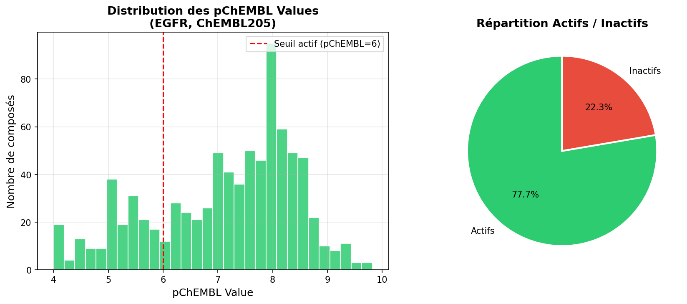
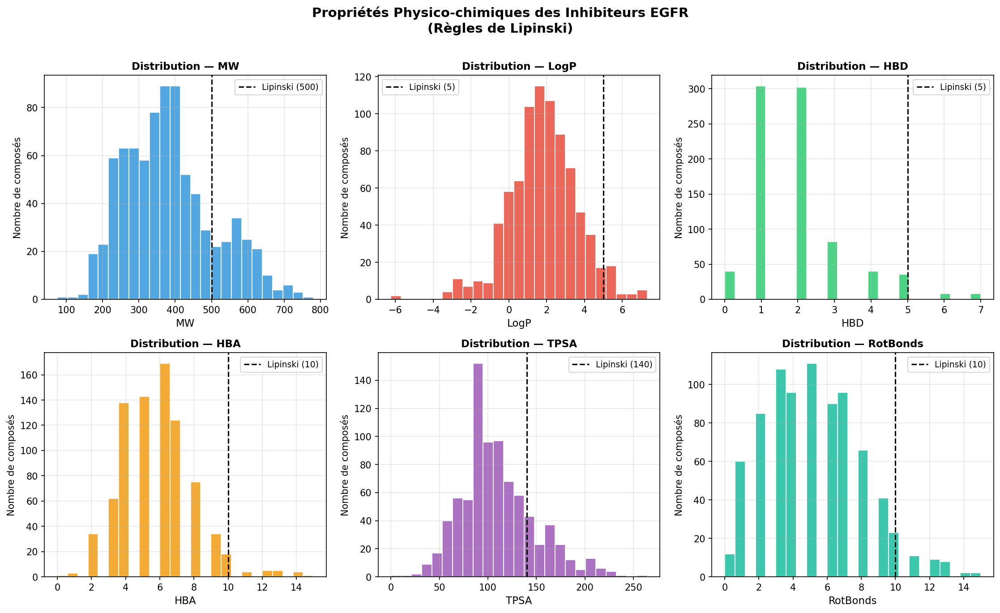
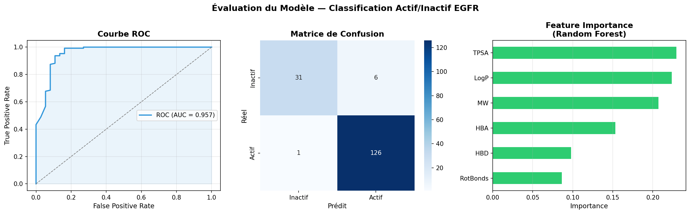

# chembl-bioactive-compounds-analysis
ML pipeline for bioactivity prediction of plant-derived compounds using ChEMBL data
# Exploratory Analysis of Bioactive Compounds Targeting EGFR

## Overview
Machine learning pipeline for bioactivity classification of compounds targeting EGFR 
(Epidermal Growth Factor Receptor, ChEMBL205) — a major oncology target overexpressed 
in lung, breast, and colorectal cancers.

## Results
- **820 compounds** retrieved and curated from ChEMBL database
- **Random Forest classifier** achieving **AUC-ROC = 0.957** and **96% accuracy**
- TPSA and LogP identified as the most predictive physicochemical descriptors

## Pipeline
1. Data retrieval from ChEMBL via Python API
2. Data cleaning and curation (deduplication, missing value removal)
3. Activity labeling (active: pChEMBL ≥ 6, IC50 ≤ 1µM)
4. Physicochemical descriptor calculation (RDKit): MW, LogP, HBD, HBA, TPSA, RotBonds
5. Lipinski's Rule of Five analysis
6. Random Forest classification with ROC/AUC evaluation

## Key Visualizations

## Technologies
- Python 3.11
- pandas, numpy, matplotlib, seaborn
- scikit-learn (RandomForestClassifier)
- RDKit (cheminformatics)
- ChEMBL Web Resource Client

## Author
Hakim Ben Hamouda — Biological Engineering Student, INSAT Tunis  
hakimbenhamouda2@gmail.com